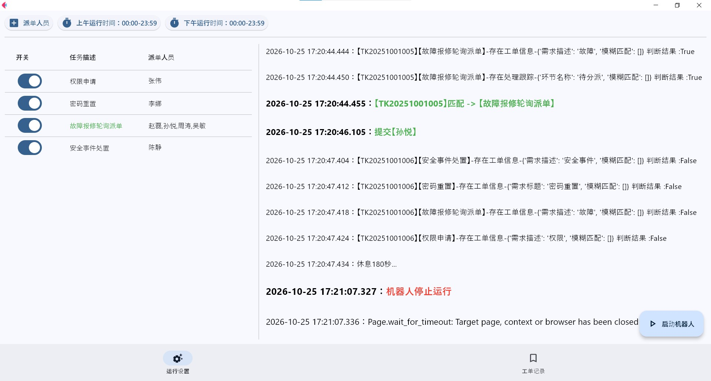
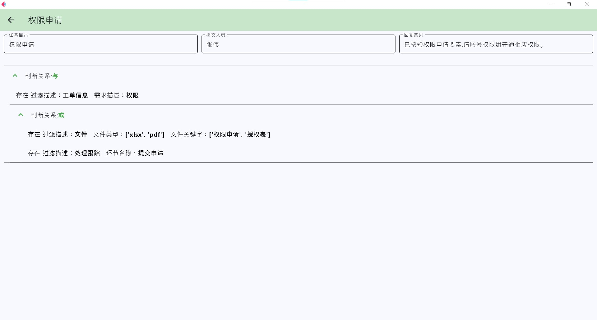
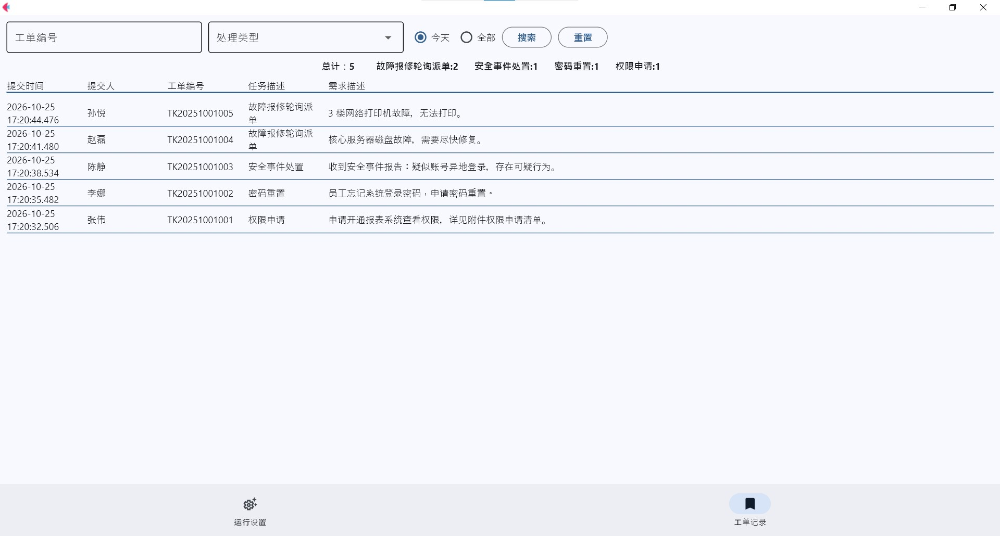
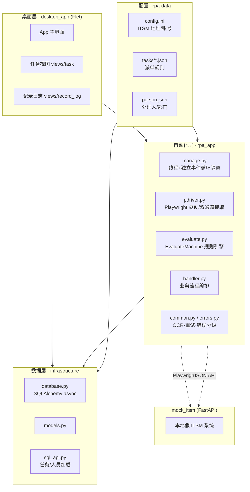
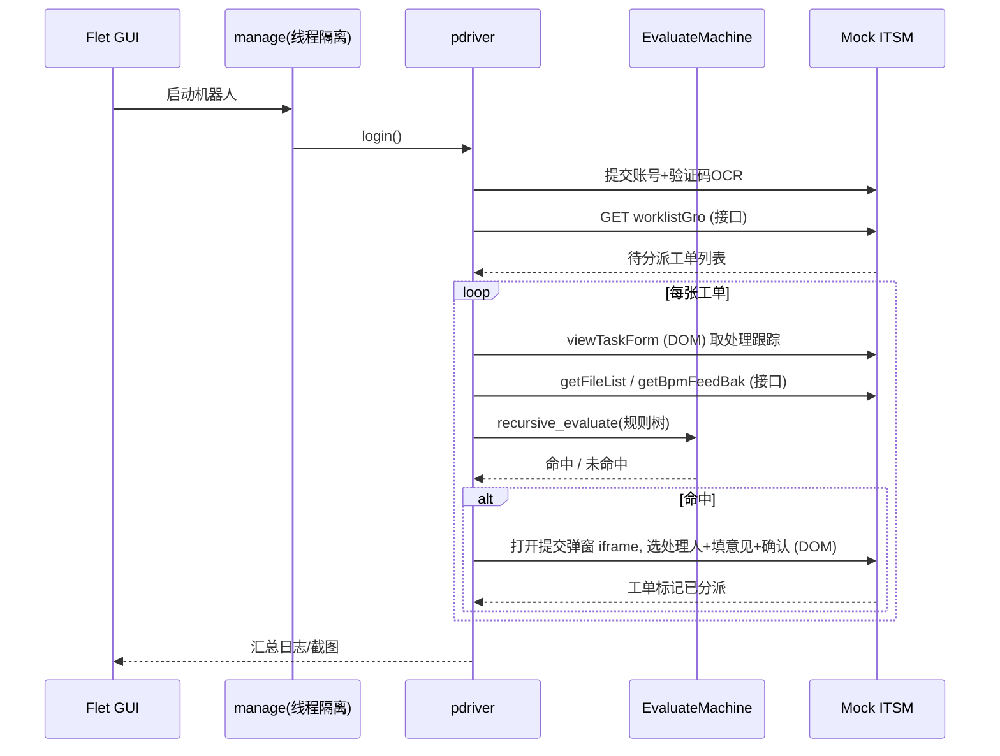

<div align="center">

# 🤖 ITSM 工单自动分派机器人

**配置驱动的 ITSM 工单 RPA —— 登录 → 抓取 → 规则匹配 → 自动派单**

**克隆即跑**：内置本地 Mock ITSM 服务，无需任何真实系统即可端到端复现全流程

[](#)
[](#)
[](#)
[](#)
[](#)

> ⚠️ 通用化重做的**演示作品**：页面 / 账号 / 部门 / 人员 / 工单均为虚构，`demo / demo123` 仅用于本地 Mock，**不涉及任何真实系统或凭据**。

<!-- TODO(作者)：可选封面横幅，放到 docs/assets/hero.png -->
<!--  -->

</div>

---

## 目录

- [它解决什么问题](#它解决什么问题)
- [演示效果](#演示效果)
- [核心亮点](#核心亮点)
- [架构设计](#架构设计)
- [快速开始](#快速开始)
- [三个自验证脚本](#三个自验证脚本)
- [如何新增一条分派规则](#如何新增一条分派规则)
- [项目结构](#项目结构)
- [技术栈](#技术栈)
- [免责声明](#免责声明)

---

## 它解决什么问题

企业 ITSM 系统里每天会有大量「待分派工单」，需要人工阅读需求、翻看附件与处理跟踪，再判断转给哪个团队/哪个人。这类工作**重复、规则明确、判断标准固定**，天然适合 RPA。

本 demo 把「人读工单 → 人判规则 → 人派单」整条链路自动化：

```text
待分派工单 → 抓取(列表/详情/附件/反馈) → 规则引擎匹配 → 选处理人并提交 → 工单被分派
```

最关键的一点：**规则不写死在代码里**，而是用 JSON 表达的逻辑表达式（AND / OR 嵌套 + 中文字段别名）。业务人员即可增删改派单策略，全程不动代码。

---

## 演示效果

> 三张真实运行截图，对应「**配置 → 规则 → 结果**」三步。录屏文件较大不适合入库，这里统一用静态截图讲流程。

### ① 运行控制台 · 规则开关 + 实时派单日志



> 左侧是 4 条规则的**开关**与对应派单人员（权限申请→张伟、密码重置→李娜、故障报修轮询派单→赵磊/孙悦/周涛/吴敏、安全事件处置→陈静）；右侧实时打印每张工单的**匹配判断**（True/False）、**命中规则**（`匹配 -> 故障报修轮询派单`）与**派单动作**（`提交【孙悦】`）。无关咨询单对所有规则均为 False，自动跳过。

### ② 可视化规则编辑器 · AND / OR 逻辑树



> 「权限申请」规则详情：`判断关系:与` 嵌套 `判断关系:或`，叶子即「工单信息-需求描述:权限」「文件-类型/关键字」「处理跟踪-环节名称:提交申请」。**这正是 JSON 配置在 GUI 里的可视化呈现**——业务人员看图即懂，无需读代码。

### ③ 派单结果台账



> 本轮共派单 **5** 张并按规则分类：故障报修轮询派单 2、安全事件处置 1、密码重置 1、权限申请 1。轮询规则把两张故障单分别派给了 **孙悦 / 赵磊**，直观体现组内轮流分派。

### 🖥️ 命令行验证（无需 GUI，已实测通过）

```text
# 规则引擎离线演示：4 条规则 × 6 张工单，正确派单 4 张、过滤 1 张无关工单
$ python demo_rule_engine.py

# Mock 服务路由冒烟：11 项断言全过（含 /reset 一键复位）
$ python check_mock.py
... reset ok, tickets 5->6
ALL MOCK CHECKS PASSED

# 无头浏览器端到端：登录 / 抓取 / 匹配 / 提交，待办工单 6 -> 5
$ python check_e2e.py
E2E 全流程通过: 登录 / 抓取 / 匹配 / 提交 均 OK
```

---

## 核心亮点

### 1. 配置驱动的规则引擎（最核心）

派单逻辑用 JSON 表达一棵 **AND / OR 嵌套的逻辑树**，由递归求值器 `EvaluateMachine` 解释执行。叶子节点是对工单各数据源的字段断言，支持**中文字段别名**直接作键，可读性极强：

```jsonc
{
  "task_desc": "权限申请",                       // 规则名(命中日志会显示)
  "task_type": 1,
  "submit_person": [                             // 命中后派给谁
    { "name": "张伟", "department": ["技术支持中心", "账号权限组"], "role": 1 }
  ],
  "submit_reply": "已核验权限申请要素，请开通相应权限。",
  "condition": {
    "filter_type": "and",                        // 逻辑与(and / or，可任意嵌套)
    "filter_content": [
      {                                          // 叶子：中文别名直接作键，值为断言
        "filter_desc": "工单信息",
        "需求描述": "权限",                        // 需求描述包含"权限"
        "is_or_not": true                         // true=命中该条件
      },
      {
        "filter_type": "or",                      // 或：附件类型 或 处理跟踪环节
        "filter_content": [
          { "filter_desc": "文件", "文件类型": ["xlsx", "pdf"], "文件关键字": ["权限申请", "授权表"], "is_or_not": true },
          { "filter_desc": "处理跟踪", "环节名称": "提交申请", "is_or_not": true }
        ]
      }
    ]
  }
}
```

- **数据源别名**：`工单信息` / `文件` / `处理跟踪` / `反馈信息`，各自映射到可读中文字段。
- **类型判别**：靠 `filter_desc` 的 `Literal` 值 + 必填 `is_or_not`，让 Pydantic `Union` 自动路由到正确模型。
- **轮询派单**：`task_type2`（RING_SEND）可在值班组内轮流分派。

### 2. 接口 + DOM 双通道抓取

| 通道 | 用于 | 优点 |
|------|------|------|
| **JSON 接口** | 列表 / 附件 / 反馈 | 快、稳、不受前端改版影响 |
| **Playwright DOM(XPath)** | 处理跟踪表 / 提交派单 | 应对纯前端渲染与真实交互 |

两条通道在驱动层统一封装，取长补短。

### 3. RPA 线程隔离

RPA 跑在独立的 `ThreadPoolExecutor` + 独立 `ProactorEventLoop` 中，与 Flet GUI 主线程完全隔离：界面不卡、异步互不干扰、可随时启停。

### 4. 验证码 OCR 自动登录

登录页验证码用 `ddddocr` 做本地 OCR 识别，配合「失败重试」实现全自动登录，无需人工介入。

### 5. 错误分级

`IgnoreError`（跳过当前工单继续跑）与 `ExitError`（致命错误停机）分级处理，保证批量任务健壮性。

### 6. 自带 Mock，克隆即跑 + 一键复位

`mock_itsm/` 是一套完整的 FastAPI 假 ITSM（登录 / 验证码图片 / 工单列表接口 / 详情表单 / 处理跟踪表 / 提交弹窗 iframe / 派单落库），让整条 RPA 链路可在**任何机器本地离线复现**——这也是本 demo 能公开的前提。
工作台内置**「重置演示」**按钮（`POST /itsm/admin/reset`），录屏时点一下即回到初始 6 张工单，无需重启服务。

---

## 架构设计

### 分层结构



### 单次派单数据流



---

## 快速开始

> 环境：**Python 3.11+** 与 [uv](https://github.com/astral-sh/uv)（用 pip 亦可）。

```bash
# ① 安装依赖（本 demo 目录下）
uv pip install -r requirements.txt

# ② 安装 Playwright 浏览器（一次性）
uv run python -m playwright install chromium

# ③ 启动 Mock ITSM 服务（窗口 A）
uv run uvicorn mock_itsm.app:app --port 8000

# ④ 启动桌面 GUI（窗口 B）
uv run python main.py
```

- 浏览器打开 <http://localhost:8000/itsm/login> 即见假 ITSM 登录页，账号 `demo` / `demo123`。
- 在 GUI 点**启动机器人**：自动登录 → 抓取 → 匹配 → 派单，结果写入 `rpa-data/` 日志与截图；回 Mock 页面刷新可见「待分派工单」减少。
- demo 已放开为**全天可跑**（非工作时段仅弹窗确认）。
- 想重来一遍：Mock 工作台点**重置演示**，或 `curl -X POST http://localhost:8000/itsm/admin/reset`。

> 💡 想用本机 Chrome/Edge：设环境变量 `ITSM_BROWSER_PATH` 指向可执行文件；留空则用上一步安装的 Chromium。
> ⚡ 不想装 GUI：直接 `uv run python check_e2e.py`（无头浏览器）一条命令验证整条链路。

---

## 三个自验证脚本

从「引擎逻辑」到「完整浏览器链路」逐层验证，演示时可分别展示：

| 脚本 | 作用 | 依赖 | 需要浏览器 |
|------|------|------|:--:|
| `demo_rule_engine.py` | 规则引擎**离线**演示：4 规则 × 6 工单的匹配/派单结果 | 无（纯内存） | 否 |
| `check_mock.py` | Mock **路由冒烟**：登录/验证码/列表/详情/提交/复位 11 项断言 | FastAPI TestClient | 否 |
| `check_e2e.py` | **端到端**：真实 Playwright 登录(含 OCR)→抓取→匹配→DOM 提交 | Playwright | 是（无头） |

```bash
uv run python demo_rule_engine.py
uv run python check_mock.py
uv run python check_e2e.py          # 需先 playwright install chromium
```

---

## 如何新增一条分派规则

1. 在 `rpa-data/tasks/` 复制一个现有 JSON 改之：
   - `task_desc`：规则名称（命中日志会显示）。
   - `condition`：逻辑树，`filter_type: and/or` + `filter_content` 可任意嵌套；叶子用 `filter_desc` 指明看哪个数据源（`工单信息`/`文件`/`处理跟踪`/`反馈信息`），直接把**中文字段名当键**写断言值，并用 `is_or_not` 控制取反。
   - `submit_person`：命中后派给谁（需与 `rpa-data/person.json` 中的人对应）。
2. 在 `rpa-data/person.json` 里维护处理人与部门。
3. 重启 GUI（或跑 `demo_rule_engine.py`）即可看到新规则生效——**全程不改代码**。

---

## 项目结构

```text
itsm-rpa-demo/
├── main.py                     # Flet 桌面应用入口
├── test.py                     # RPA 手工联调入口
├── demo_rule_engine.py         # 规则引擎离线演示
├── check_mock.py               # Mock 路由冒烟测试(含 reset)
├── check_e2e.py                # 无头浏览器端到端测试
├── requirements.txt
├── itsm_collect_app/           # 主应用包
│   ├── settings.py             # 配置模型(App/Itsm/RpaTimeConfig)
│   ├── schema.py               # Pydantic 模型(规则/工单/人员)
│   ├── desktop_app/            # Flet GUI
│   │   ├── app.py
│   │   └── views/              # index / task / record_log
│   ├── rpa_app/                # RPA 自动化
│   │   ├── manage.py           # 线程 + 独立事件循环隔离
│   │   ├── pdriver.py          # Playwright 驱动 / 双通道抓取 / 提交
│   │   ├── evaluate.py         # EvaluateMachine 规则引擎
│   │   ├── handler.py          # 业务流程编排
│   │   ├── common.py           # OCR / 重试 等
│   │   └── errors.py           # 错误分级(IgnoreError / ExitError)
│   └── infrastructure/         # SQLAlchemy async 数据层
│       ├── database.py
│       ├── models.py
│       └── sql_api.py
├── mock_itsm/                  # 本地假 ITSM 系统(FastAPI)
│   └── app.py                  # 含 /reset 一键复位
├── docs/assets/                # README 截图素材
└── rpa-data/                   # 运行时数据(干净通用示例)
    ├── config.ini              # ITSM 地址/账号(指向 localhost:8000)
    ├── person.json             # 处理人/部门(虚构)
    ├── tasks/                  # 派单规则 JSON(4 条)
    ├── chinese-days/           # 工作日日历
    ├── screenshots/            # 运行截图(已 gitignore)
    └── itsm.db                 # SQLite(自动创建,已 gitignore)
```

---

## 技术栈

| 领域 | 选型 |
|------|------|
| 语言 / 包管理 | Python 3.11 · uv |
| 桌面 GUI | Flet |
| 浏览器自动化 | Playwright (Chromium) |
| 验证码识别 | ddddocr (本地 OCR) |
| 数据库 | SQLite + SQLAlchemy 2.0 async + aiosqlite |
| 数据校验 / 规则模型 | Pydantic v2（Union + Literal 判别） |
| Mock 服务 | FastAPI + Uvicorn |
| 日志 | loguru（info / error 分文件轮转） |

---

## 免责声明

- 本项目为**通用化重做的演示作品**，用于展示 RPA + 配置驱动规则引擎的工程能力。
- 所有页面、接口、部门、人员、工单数据均为**虚构**；`demo / demo123` 仅用于本地 Mock 服务，**不涉及任何真实企业系统、内网地址或凭据**。
- 原始业务系统、真实数据与本 demo 无任何关联，本 demo 可安全公开。

---

<div align="center">

**如果这个项目让你觉得「规则也能这样优雅地配置化」，欢迎点个 ⭐ 交流**

</div>
